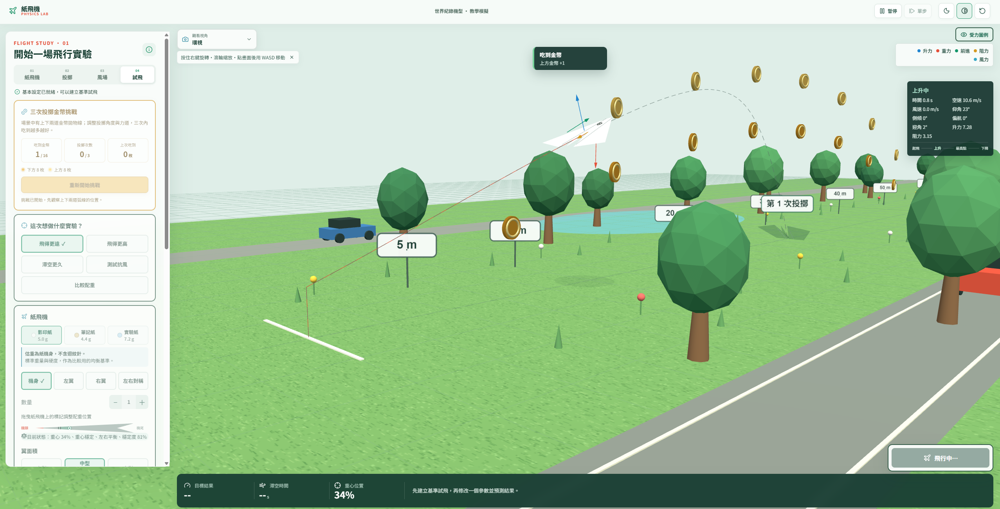

# Suzanne 紙飛機飛行實驗室

Suzanne 紙飛機飛行實驗室是一個互動式 3D 教學作品。學生可以調整紙飛機、投擲方式和風場，觀察飛機怎麼起飛、偏航、失速和落地，並比較不同設定對飛行結果的影響。


## 可以做什麼

- 選擇實驗目標：飛得更遠、更高、滯空更久、測試抗風或比較配重。
- 調整紙飛機：選擇小、中、大翼面積，設定迴紋針數量、位置和左右配重。
- 比較三種紙張：影印紙約 5.0 g、筆記紙約 4.4 g、實驗紙約 7.2 g（紙機身估值，不含迴紋針）；紙張重量、阻力與柔軟度會進入簡化飛行模型，卡片會說明各自的飛行傾向。
- 調整投擲：設定 0° 到 90° 的投擲角度、投擲力道和初始高度。待飛預覽會同步呈現機頭角度和出手方向；力道越大，方向箭頭越長。
- 依照「紙飛機、投擲、風場、試飛」四步驟導覽設定；滑桿標示目前數值與範圍，設定狀態會提示下一個操作。
- 切換深色與高對比顯示、紙張色調；鏡頭操作提示可關閉，風向羅盤、選取狀態與儀表協助辨識目前設定。
- 選擇風場：設定正面風、左側風、右側風、平均風速及晴天、下雨或颱風情境；快速實驗按鈕可直接套用一組設定。
- 觀察即時簡化氣動力學：飛行途中更新位置、速度、仰俯、側傾、風力、升力和阻力；也可以暫停、單步播放、查看受力箭頭或慢動作重播。
- 查看實驗結果：記錄飛行距離、最高高度、滯空時間、重心和側偏，並和前一次結果比較。
- 在底部結果面板切換高度、速度、側傾或風速圖表，觀察數值如何隨飛行時間改變；第二次試飛後，圖表會以實線和虛線對照本次與上次曲線，事件標記也會指出失速等飛行狀況。
- 重播可選 0.5×、1×、2× 速度，播放期間可拖曳時間軸；即時儀表同步顯示飛行階段、姿態與受力資訊。
- 保留落地紀錄：每次試飛落地後，場景會留下半透明紙飛機殘影及「第 N 次投擲」標籤；重播不會另算一次。紀錄保留到重新載入頁面。
- 進行三次投擲金幣挑戰：場景會出現上下兩道拋物線金幣，每枚金幣只能計分一次；完成三次投擲後顯示吃到的總數。
- 在延伸到 100 公尺的場景中觀察距離；場地距離刻度標示至 100 公尺。

## 相較原始範本的新增與改進

原始範本已提供 3D 紙飛機、配重、投擲參數、風向天氣和飛行重播。這個版本在原有基礎上新增或強化以下功能：

- **即時簡化飛行物理：** 飛行途中持續更新位置、速度、仰俯、側傾與偏航，並依風場、翼面積和配重估算升力、阻力與其他受力；可呈現失速、偏航和姿態變化。
- **更多飛機與風場變因：** 增加小、中、大翼面積與三種紙張選擇，顯示紙張重量和飛行傾向；風場可設定陣風、亂流及快速實驗情境。
- **步驟式實驗與預測：** 增加實驗目標選擇、基本設定流程和快速情境。學生可先預測飛行結果，再試飛並比較結果。
- **飛行分析與紀錄：** 增加高度、速度、側傾、風速圖表，支援本次與上次曲線比較、飛行事件標記、暫停和單步播放；落地後會留下投擲次數與飛機殘影。
- **三次投擲金幣挑戰：** 新增收集飛行路徑上金幣的挑戰，最多投擲三次並統計得分；重播不會重複計分。
- **場景和鏡頭操作：** 場地距離延伸至 100 公尺，提供側視、跟隨、全景和環視；環視支援滑鼠旋轉、滾輪縮放與 WASD 移動，調整參數後可平順回到發射位置。
- **介面易讀性：** 加寬參數區並放大文字與按鈕，整理設定步驟、選取狀態和飛行資訊；預設高對比模式，另提供深色模式。
- **GitHub Pages 發布：** 加入 GitHub Actions 工作流程，自動安裝依賴、建置 Vite 專案並發布 `dist/`。

以上物理效果屬於教學用的簡化估算，不是精確的風洞或 CFD 模擬。紙翼彎曲目前是視覺效果，不會改變氣動力計算。

## 操作畫面

左側面板依序整理實驗目標、紙飛機、投擲和風場設定。綠色按鈕表示目前選中的實驗目標或情境。進階氣流參數可展開調整；預測選項會出現在右下方試飛按鈕旁。

### 風場實驗

透過快速情境或控制項調整風向、平均風速、陣風和天氣。下圖展示颱風設定下的雨勢與風場；學生可以觀察風如何推動紙飛機並改變飛行姿態。


### 飛行軌跡和結果

飛行時，紅色軌跡呈現這次飛行，虛線可用來和前一次比較。右下角先選擇結果預測，再進行下一次試飛；底部結果面板會顯示飛行距離、滯空時間、重心與和上次結果的差異。下方圖表可切換高度、速度、側傾和風速，橫軸代表飛行時間；進行第二次試飛後，實線代表本次、虛線代表上次，失速等事件會標在曲線上。


### 落地歷史

每次完成試飛後，落點會留下編號殘影，可直接比較多次飛行的大致落點和姿態。


### 三次投擲金幣挑戰

按下「開始金幣挑戰」後，場景會在同一條前進路線上生成上、下兩道金幣拋物線。下方弧線較低，上方弧線較高且更陡；學生可以調整投擲角度、力道、配重與風場，嘗試讓紙飛機碰到金幣。挑戰最多進行三次投擲，慢動作重播不會重複計分，完成後會顯示得分並回到一般模擬，可以繼續試飛。



## 鏡頭操作

- 從「觀看視角」選擇側視、跟隨、全景或環視；選單會標明各視角用途。
- 按住滑鼠右鍵並拖曳可旋轉視角；滾輪可縮放。
- 點選 3D 畫面後，可用 `W`、`A`、`S`、`D` 平移鏡頭。
- 可在環視、側視、跟隨和全景模式間切換。環視模式下，飛行時鏡頭不會自動跟著飛機，方便觀察整段軌跡。
- 飛機落地後調整參數，飛機會回到發射位置；鏡頭會平順移回並重新對準飛機。

## 安裝與啟動

需要 Node.js 20 或更新版本，以及 pnpm。

```bash
pnpm install --frozen-lockfile
pnpm dev
```

開啟終端機顯示的本機網址即可操作。停止開發伺服器時，在該終端機按 `Ctrl+C`。

## 建置與部署

```bash
pnpm build
```

建置檔會輸出到 `dist/`。專案使用相對資源路徑，可將 `dist` 內容部署到靜態網站服務或 XAMPP 子資料夾，例如 `C:\xampp\htdocs\paperplane\`。

## 模擬範圍與限制

本作品使用即時簡化氣動力學，根據風、速度、迎角、翼面積和配重估算飛機受力及姿態變化；它不是逐點計算空氣流動的 CFD 或風洞模擬。氣動係數、失速條件和場景尺度都是教學近似，適合比較變因，不適合當作真實紙飛機飛行距離的精準預測。機翼柔軟度目前呈現紙翼彎曲效果，不會改變氣動力計算。

## 技術

- React 19
- Vite 7
- Three.js
- Lucide React

## 課堂建議

先選一個快速情境完成基準試飛，預測結果後每次只改一項參數，再比較距離、高度、滯空時間和落點。可以用受力箭頭和落地編號紀錄討論風向、翼面積與配重造成的差異。

## 授權

本專案採用 [MIT License](LICENSE)。
