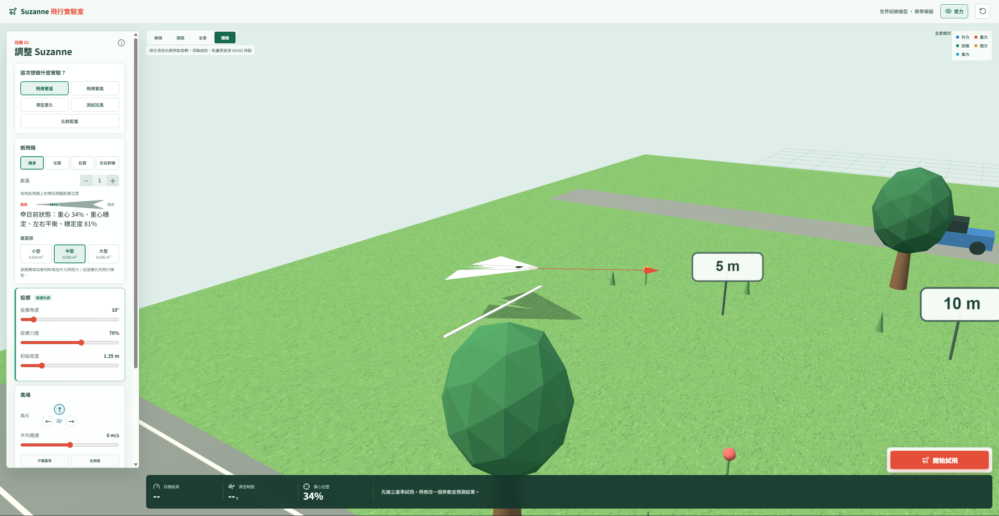
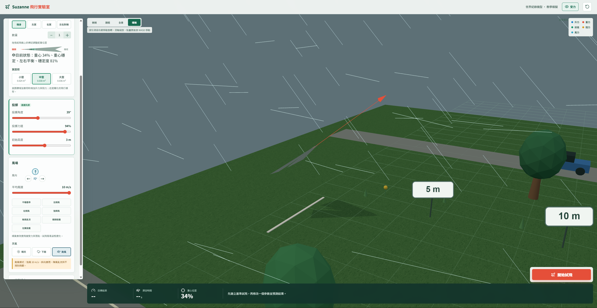
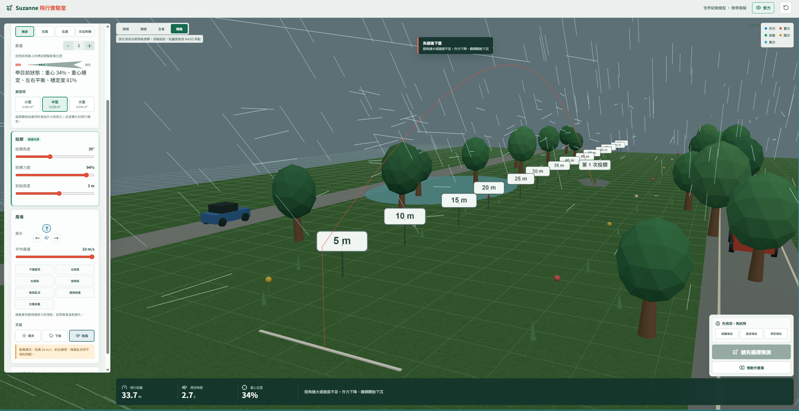
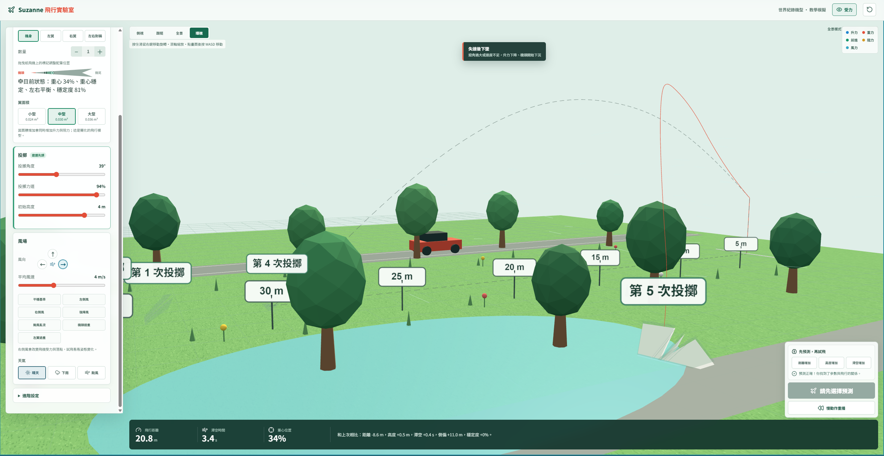

# Suzanne 紙飛機飛行實驗室

Suzanne 紙飛機飛行實驗室是一個互動式 3D 教學作品。學生可以調整紙飛機、投擲方式和風場，觀察飛機怎麼起飛、偏航、失速和落地，並比較不同設定對飛行結果的影響。



## 可以做什麼

- 選擇實驗目標：飛得更遠、更高、滯空更久、測試抗風或比較配重。
- 調整紙飛機：選擇小、中、大翼面積，設定迴紋針數量、位置和左右配重。
- 調整投擲：設定 0° 到 90° 的投擲角度、投擲力道和初始高度。待飛預覽會同步呈現機頭角度和出手方向；力道越大，方向箭頭越長。
- 依照「紙飛機、投擲、風場、試飛」四步驟導覽設定；滑桿標示目前數值與範圍，設定狀態會提示下一個操作。
- 切換深色與高對比顯示、紙張色調；鏡頭操作提示可關閉，風向羅盤、選取狀態與儀表協助辨識目前設定。
- 選擇風場：設定正面風、左側風、右側風、平均風速及晴天、下雨或颱風情境；快速實驗按鈕可直接套用一組設定。
- 觀察即時簡化氣動力學：飛行途中更新位置、速度、仰俯、側傾、風力、升力和阻力；也可以暫停、單步播放、查看受力箭頭或慢動作重播。
- 查看實驗結果：記錄飛行距離、最高高度、滯空時間、重心和側偏，並和前一次結果比較。
- 查看高度、速度、側傾或風速圖表，並在曲線上辨認陣風、失速、側傾與恢復平衡等飛行事件；落地波紋和不同顏色的歷史殘影標示各次投擲。
- 重播可選 0.5×、1×、2× 速度，播放期間可拖曳時間軸；即時儀表同步顯示飛行階段、姿態與受力資訊。
- 保留落地紀錄：每次試飛落地後，場景會留下半透明紙飛機殘影及「第 N 次投擲」標籤；重播不會另算一次。紀錄保留到重新載入頁面。
- 在約 70 公尺的場景中觀察距離；最遠距離標記為 70 公尺。

## 操作畫面

左側面板依序整理實驗目標、紙飛機、投擲和風場設定。綠色按鈕表示目前選中的實驗目標或情境。進階氣流參數可展開調整；預測選項會出現在右下方試飛按鈕旁。

### 風場實驗

透過快速情境或控制項調整風向、平均風速、陣風和天氣。下圖展示颱風設定下的雨勢與風場；學生可以觀察風如何推動紙飛機並改變飛行姿態。



### 飛行軌跡和結果

飛行時，紅色軌跡呈現這次飛行，虛線可用來和前一次比較。右下角可以先選擇預測，再進行下一次試飛；底部儀表顯示本次結果。



### 落地歷史

每次完成試飛後，落點會留下編號殘影，可直接比較多次飛行的大致落點和姿態。



## 鏡頭操作

- 按住滑鼠右鍵並拖曳可旋轉視角；滾輪可縮放。
- 點選 3D 畫面後，可用 `W`、`A`、`S`、`D` 平移鏡頭。
- 可在環視、側視、跟隨和全景模式間切換。環視模式下，飛行時鏡頭不會自動跟著飛機，方便觀察整段軌跡。
- 飛機落地後調整參數，飛機會回到發射位置；鏡頭會平順移回並重新對準飛機。

## 安裝與啟動

需要 Node.js 20 或更新版本，以及 pnpm。

```bash
pnpm install --frozen-lockfile
pnpm dev
```

開啟終端機顯示的本機網址即可操作。停止開發伺服器時，在該終端機按 `Ctrl+C`。

## 建置與部署

```bash
pnpm build
```

建置檔會輸出到 `dist/`。專案使用相對資源路徑，可將 `dist` 內容部署到靜態網站服務或 XAMPP 子資料夾，例如 `C:\xampp\htdocs\paperplane\`。

## 模擬範圍與限制

本作品使用即時簡化氣動力學，根據風、速度、迎角、翼面積和配重估算飛機受力及姿態變化；它不是逐點計算空氣流動的 CFD 或風洞模擬。氣動係數、失速條件和場景尺度都是教學近似，適合比較變因，不適合當作真實紙飛機飛行距離的精準預測。機翼柔軟度目前呈現紙翼彎曲效果，不會改變氣動力計算。

## 技術

- React 19
- Vite 7
- Three.js
- Lucide React

## 課堂建議

先選一個快速情境完成基準試飛，預測結果後每次只改一項參數，再比較距離、高度、滯空時間和落點。可以用受力箭頭和落地編號紀錄討論風向、翼面積與配重造成的差異。

## 授權

本專案採用 [MIT License](LICENSE)。
